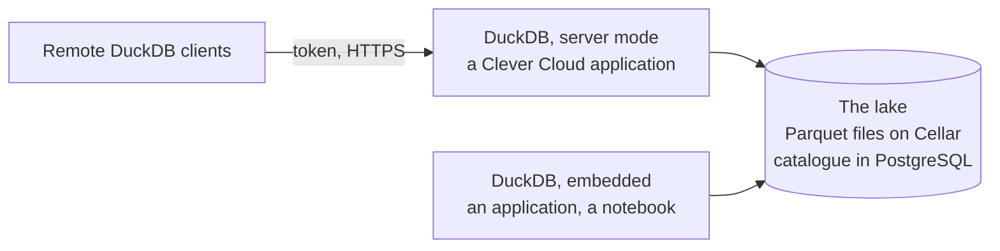

# Analyse a history of a few gigabytes to a few terabytes

A few users run analytical queries from time to time, or read dashboards. Nobody on the team
runs a cluster. The history grows, and other engines may read it later.

This tutorial builds a lake for that need. DuckDB is the engine. DuckLake is the table format.
Clever Cloud runs every service.

## Architecture



- **The tables are DuckLake tables.** Their data is Parquet files on Cellar. Their catalogue is in
  a managed PostgreSQL. The catalogue records which files make each table, and which version is
  current.
- **The catalogue takes writes in turn.** Two processes that write at the same time commit one
  after the other. No row is lost or overwritten.
- **DuckDB runs in one of two forms.** Both attach the same lake.

| Form | Where it runs | What it suits |
|---|---|---|
| Embedded | Inside your own process: a Clever Cloud application, a notebook, a scheduled task.<br>Each process attaches the lake. | Processing that lives in an application or a notebook.<br>Each process has its own memory. |
| Server | DuckDB 2.0 in server mode, in a Clever Cloud application.<br>Clients connect with a token, over HTTPS. | Several clients sharing one instance and its memory.<br>No application to write. |

## What this tutorial deploys

| Component | On Clever Cloud |
|---|---|
| The lake's files | A Cellar add-on and one bucket |
| The catalogue, and the `reporting` schema | A PostgreSQL add-on, plan `xxs_sml` by default |
| DuckDB in server mode | A Python application, one S instance by default, at `<bucket>.cleverapps.io` |

| File | Role |
|---|---|
| `main.tf` | The add-ons, the bucket, and the server application, deployed from your clone |
| `serve.py` | The server: it opens the lake and serves it to the clients that present the token |
| `pyproject.toml`<br>`uv.lock` | The server's dependencies, which Clever Cloud installs with uv |
| `check.sh` | Runs the whole example on the deployed lake, and checks each result |
| `test_serve.py` | Tests the server on a local lake |

You need `terraform`, `git`, `curl`, `psql`, the `aws` command line, and `duckdb` 2.0 or later
(https://duckdb.org/install).

## Step 1. Create the infrastructure

The bucket's name must be unique across Cellar. It also forms the server's address, so it uses
lower-case letters, digits and hyphens only. To deploy without the server, first write
`enable_server = false` in a `terraform.tfvars` file: the lake then works through embedded DuckDB
only.

```bash
export TF_VAR_organisation=<orga_xxx>
export TF_VAR_bucket_name=<a-unique-bucket-name>
terraform init
terraform apply
```

`terraform apply` takes a minute or two. Clever Cloud then builds and starts the server. A new
PostgreSQL accepts connections a minute or so after its creation, and the server waits for it.
These two loops wait for both:

```bash
export URI=$(terraform output -raw postgresql_uri)
until psql "$URI" -c 'SELECT 1' > /dev/null 2>&1; do sleep 10; done
SERVER=$(terraform output -raw server_host)
[ -z "$SERVER" ] || until curl -sf "https://$SERVER/" > /dev/null; do sleep 10; done
echo ready
```

Expected: `ready`, after a few minutes.

## Step 2. Attach the lake and write

DuckDB needs two values to attach the lake: the
Cellar keys, and the catalogue's connection string. This step writes them to a file, `lake.sql`,
that every DuckDB session reads first. The file holds credentials: `.gitignore` keeps it out of
git.

```bash
umask 077
cat > lake.sql <<SQL
CREATE SECRET cellar (TYPE s3, KEY_ID '$(terraform output -raw cellar_key_id)',
                      SECRET '$(terraform output -raw cellar_key_secret)',
                      ENDPOINT '$(terraform output -raw cellar_host)', URL_STYLE 'path', REGION 'us-east-1');
ATTACH 'ducklake:postgres:$(terraform output -raw postgresql_conninfo)' AS lake
       (DATA_PATH 's3://$(terraform output -raw bucket)/lake/', METADATA_SCHEMA 'ducklake');
USE lake;
SQL
lake() { cat lake.sql - | duckdb; }
```

`umask 077` makes the file readable by you only. `lake` is a shell function: it starts a DuckDB,
runs `lake.sql`, then runs the SQL it reads on its standard input. Each call is a new DuckDB
process.

DuckDB creates a table and writes three rows:

```bash
lake <<'SQL'
CALL lake.set_option('data_inlining_row_limit', 0);
CREATE TABLE events (writer INTEGER, n INTEGER);
INSERT INTO events VALUES (0, 1), (0, 2), (0, 3);
SELECT count(*) FROM events;
SQL
```

Expected, in the last table DuckDB prints: `3`.

By default, DuckLake keeps small inserts inside the catalogue until there is enough to write a
file. With `data_inlining_row_limit` set to 0, every insert becomes a Parquet file on Cellar, so
the example shows the files. The option is stored in the catalogue: it applies to every client.

## Step 3. Write from two processes at once

Two DuckDB processes write ten rows each to the same table, at the same time. Each row is its
own commit.

```bash
for writer in 1 2; do
  for i in $(seq 10); do echo "INSERT INTO events VALUES ($writer, $i);"; done | lake > /dev/null &
done
wait
echo "SELECT writer, count(*) FROM events GROUP BY writer ORDER BY writer;" | lake
```

Expected: 3 rows for writer 0, and 10 each for writers 1 and 2. The catalogue accepts one commit
at a time. When a writer's commit comes second, DuckLake retries it on the new version of the
table.

## Step 4. Read from another DuckDB

The server is another DuckDB, on Clever Cloud, attached to the same lake. Quack is the name of
DuckDB's server protocol: the `quack:` prefix selects it. A client connects with the token, over
HTTPS:

```bash
TOKEN=$(terraform output -raw quack_token)
duckdb -c "ATTACH 'quack:$SERVER:443' AS server (TOKEN '$TOKEN'); SELECT count(*) FROM server.events;"
```

Expected: `23`. The query runs on the server, with the server's memory. The client needs DuckDB
2.0 and the token. A client without the token gets `Authentication failed`.

The token gives full access to the lake: a client with it reads and writes every table. It gives
nothing else. The server refuses to read files or its environment, to write files, and to load
extensions, and no client can change these settings.

An embedded DuckDB, in an application or a notebook, sees the same table with the `ATTACH` of
step 2.

## Step 5. Read the table as it was

Each commit is a snapshot of the lake. DuckDB reads any of them.

```bash
lake <<'SQL'
SET VARIABLE before = (SELECT max(snapshot_id) FROM lake.snapshots());
INSERT INTO events VALUES (3, 1);
SELECT (SELECT count(*) FROM events) AS now,
       (SELECT count(*) FROM events AT (VERSION => getvariable('before'))) AS before;
SQL
```

Expected: `24` now, `23` before.

## Step 6. Copy a table for reporting tools

Reporting tools read PostgreSQL through their own connector. DuckDB copies an aggregate into the
`reporting` schema of the same PostgreSQL:

```bash
URI=$(terraform output -raw postgresql_uri)
lake <<SQL
ATTACH '$(terraform output -raw postgresql_conninfo)' AS pg (TYPE postgres);
CALL postgres_execute('pg', 'CREATE SCHEMA IF NOT EXISTS reporting');
CREATE OR REPLACE TABLE pg.reporting.events_per_writer AS
SELECT writer, count(*) AS n FROM events GROUP BY writer;
SQL
psql "$URI" -c 'SELECT * FROM reporting.events_per_writer ORDER BY writer'
```

Expected: 4 rows, one per writer. A reporting tool connects with the values of
`terraform output -raw postgresql_uri`, and reads the `reporting` schema. The `ducklake` schema
belongs to the catalogue.

## Step 7. Clean up

Cellar refuses to delete a bucket that still holds files, so the first command empties it. The
`aws` command line needs a region value; Cellar accepts `us-east-1`. Run these commands with the
`TF_VAR_*` variables of step 1 still exported: without them, `terraform destroy` waits for you to
type their values.

```bash
AWS_ACCESS_KEY_ID=$(terraform output -raw cellar_key_id) \
AWS_SECRET_ACCESS_KEY=$(terraform output -raw cellar_key_secret) AWS_DEFAULT_REGION=us-east-1 \
  aws s3 rm "s3://$(terraform output -raw bucket)" --recursive --endpoint-url "https://$(terraform output -raw cellar_host)"
terraform destroy
rm -f lake.sql
```

`terraform destroy` removes the add-ons, the catalogue and its `reporting` schema included, and
the server.

## To adapt

- **Your own data.** DuckDB reads Parquet, CSV and JSON files, local or on Cellar, and creates a
  table from them: `CREATE TABLE sales AS SELECT * FROM read_parquet('s3://<bucket>/raw/*.parquet')`.
  `INSERT INTO sales SELECT * FROM read_csv('new.csv')` adds rows.
- **Small inserts.** On your own lake, the default inlining keeps inserts of up to 10 rows in the
  catalogue until there is enough to write a file: `CALL lake.set_option('data_inlining_row_limit', 10)`.
- **Upkeep.** Many small commits make many small files, and each snapshot keeps its files.
  `CALL ducklake_merge_adjacent_files('lake')` merges small files.
  `CALL ducklake_expire_snapshots('lake', older_than => now() - INTERVAL 30 DAYS)` removes the
  snapshots older than 30 days: DuckDB then no longer reads the table as it was before.
  `CALL ducklake_cleanup_old_files('lake', cleanup_all => true)` deletes the files no snapshot
  uses. An orchestrator, Airflow or another, runs them on a schedule.
- **The server's size.** `server_flavor` sets the instance, and so the memory the clients' queries
  share.
- **The catalogue's plan.** `postgresql_plan` sets the number of connections. Each attached
  DuckDB holds at least one.
- **Iceberg instead of DuckLake.** More engines read Iceberg tables. The
  [second tutorial](../02-trino-iceberg/) deploys them, with a Lakekeeper catalogue.

## Limits

- **Volume.** A few terabytes. The queries' joins and aggregations have to fit in one instance's
  memory: their complexity sets the limit more than the volume.
- **Growth.** The engine grows with a larger instance.
- **Connections.** Every running query holds a connection to the catalogue, so the PostgreSQL plan
  is sized in connections.
- **Clients of the server.** Every client runs DuckDB 2.0 or later. DuckDB 2.0 writes files that
  older versions do not read. The token is one for all clients.
- **Reporting tools.** They connect with the PostgreSQL add-on's user, which also owns the
  catalogue.
- **Long queries in server mode.** The server's address goes through the platform's shared load
  balancer, which cuts a request without an answer after 3 minutes. A query through the server
  keeps its request open until its result, so a query that runs longer than 3 minutes fails with
  an HTTP 504. Long queries run in embedded DuckDB, or through a dedicated load balancer, which
  Clever Cloud sets up on request.

When the queries no longer fit one instance's memory, or many users query at the same time, the
[second tutorial](../02-trino-iceberg/) spreads them over a cluster.

## Documentation

- DuckLake: https://ducklake.select/
- DuckDB server mode: https://duckdb.org/docs/current/quack/overview
- Cellar: https://www.clever.cloud/developers/doc/deploy/storage/cellar/
- PostgreSQL: https://www.clever.cloud/developers/doc/deploy/databases/postgresql/
- Python with uv on Clever Cloud: https://www.clever.cloud/developers/doc/deploy/applications/python/uv/

## Troubleshooting

| Symptom | Cause | Fix |
|---|---|---|
| `terraform apply` refuses the bucket's name | The name is not a valid part of a domain name | Use lower-case letters, digits and hyphens. |
| `terraform apply` fails: the bucket already exists | Bucket names are unique across Cellar | Choose another `TF_VAR_bucket_name`. |
| `terraform apply` warns that the repository is unreachable | The directory is not a clone of the repository | Clone the repository with `git`.<br>Terraform deploys its checked-out commit. |
| The deployment fails: the application is not listening on 8080 | The server could not reach the catalogue within 5 minutes | Check that the PostgreSQL add-on accepts connections.<br>`clever restart --app $(terraform output -raw server_app_id)`. |
| A query through the server fails with an HTTP 504 after 3 minutes | The shared load balancer cuts a request without an answer after 3 minutes | Run the query in embedded DuckDB.<br>Ask Clever Cloud for a dedicated load balancer. |
| `ATTACH 'quack:…'` fails: unknown prefix, or the `quack` extension is missing | The local `duckdb` is older than 2.0 | Install DuckDB 2.0 or later. |
| `ATTACH 'quack:…'` fails with `Authentication failed` | The token is wrong | Use `terraform output -raw quack_token`. |
| A query through the server fails with "Permission Error" | It reads or writes outside the lake | Run it in embedded DuckDB. The server only serves the lake. |
| `ATTACH 'ducklake:…'` fails with "Unable to connect to Postgres" | The catalogue's connection limit is reached | Run `SET pg_connection_limit = <n>` in DuckDB, under the plan's limit.<br>Choose a larger `postgresql_plan`. |
| A read on the lake fails with a 403 from Cellar | The secret's keys or endpoint are wrong | Check `lake.sql`.<br>`URL_STYLE 'path'` is required. |

## Develop and test

```bash
uv sync
uv run pytest
```

The tests run the server on a local lake, connect to it as a remote client, and check that a
client cannot leave the lake.

`./check.sh` runs the whole example on the deployed lake, on a table of its own, checks each
result, then drops the table. It ends with `All checks passed.`
