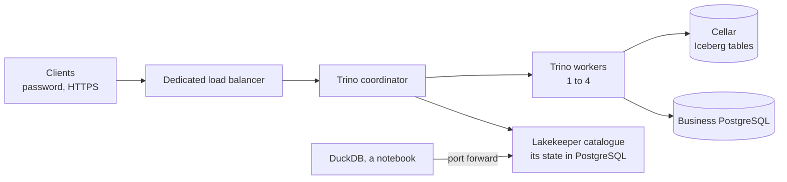

# Share a lake of several terabytes between many users

Many users query the lake at the same time. Their queries are too large for one instance, and
some of them join the lake with PostgreSQL databases.

This tutorial builds a lake for that need. The tables are Iceberg tables. Lakekeeper is their
catalogue. Trino runs the queries on a Clever Kubernetes Engine cluster, with as many workers as
the load needs.

## Architecture



- **The tables are Iceberg tables.** Their data and metadata are files on Cellar. The Lakekeeper
  catalogue records which metadata is current. It keeps its state in a managed PostgreSQL.
- **The catalogue takes writes in turn.** Lakekeeper accepts one commit at a time per table. Two
  queries that write at the same time commit one after the other. No row is lost.
- **Trino spreads the queries.** A coordinator plans them. Workers run them.
- **The workers follow the load.** An autoscaler adds workers when they are busy, and removes them
  when they are idle. A worker that leaves finishes its running tasks first. Karpenter, the
  cluster's node manager, adds the nodes the new workers need, and removes the nodes they leave
  empty.
- **Every layer has a ceiling.** At most 4 workers. A limit on the nodes Karpenter adds. A quota on
  the namespace. A query stops after 30 minutes, past 2 GB of memory on one worker, or past 8 GB
  in all. Each user runs at most 4 queries at once. Whatever the load, the cluster does not grow
  past these.
- **Trino joins the lake with PostgreSQL.** A business database is a second catalogue of Trino, so
  one SQL query reads both. In this tutorial, the business database illustrates one of yours.
- **Each user has their rights.** Clients reach Trino over HTTPS, with a user and a password. The
  user `admin` writes the lake. The user `analyst` only reads. Nobody writes to the business
  database through Trino.
- **The workers take orders from the coordinator only.** A NetworkPolicy lets in only the
  coordinator and the other workers. The users' rights are checked on the coordinator: a pod of
  the cluster cannot skip them by sending work to a worker.
- **Lakekeeper stays inside the cluster.** Only Trino reaches it, and a client outside the cluster
  goes through `kubectl port-forward`, which the cluster's credentials authenticate.
- **The engines reach Cellar with the add-on's keys.** Lakekeeper, Trino and DuckDB each get them
  in a secret.
- **Long queries have their own entry point.** The clients reach Trino through a `LoadBalancer`
  Service. Kubernetes Engine gives it a load balancer of its own, with its own public addresses,
  outside the platform's shared load balancer. Trino's client asks the coordinator for news about
  every second, so no request waits long for an answer.

## What this tutorial deploys

| Component | On Clever Cloud |
|---|---|
| The lake | A Cellar add-on and one bucket |
| The catalogue's state | A PostgreSQL add-on |
| A business database | A second PostgreSQL add-on, which illustrates one of yours.<br>Optional. |
| The cluster | Clever Kubernetes Engine: one fixed S node, and the nodes Karpenter adds |
| The catalogue | Lakekeeper, one pod, on the fixed node |
| The engine | Trino: a coordinator on the fixed node, and from 1 to 4 workers |
| The clients' entry point | A dedicated load balancer, from a `LoadBalancer` Service |

| File | Role |
|---|---|
| `main.tf` | The add-ons, the bucket, the cluster with Karpenter and its fixed node, and Lakekeeper's encryption key |
| `nodepool.yaml` | The nodes Karpenter may add, and their limit |
| `namespace.yaml` | The `lake` namespace |
| `lakekeeper.yaml` | The Iceberg catalogue, and the NetworkPolicy that lets in Trino only |
| `warehouse.yaml` | A job that declares the warehouse to the catalogue |
| `trino-public.yaml` | The clients' entry point, a `LoadBalancer` Service |
| `trino.yaml` | Trino's coordinator, workers, catalogues, users' rights, limits on queries, and the NetworkPolicy of the workers |
| `trino-business.yaml` | The business database, as a catalogue of Trino |
| `trino-autoscaling.yaml` | The workers' autoscaler, and the namespace's quota |
| `query.py` | Runs SQL on Trino through the load balancer, over HTTPS with a password |
| `test_query.py` | Tests `query.py` |

You need `terraform`, `kubectl`, `openssl`, `htpasswd` (in the `apache2-utils` or `httpd-tools`
package on Linux), `psql`, `uv`, `duckdb` and the `aws` command line.

## Step 1. Create the managed services and the cluster

The bucket's name must be unique across Cellar.

```bash
export TF_VAR_organisation=<orga_xxx>
export TF_VAR_bucket_name=<a-unique-bucket-name>
terraform init
terraform apply
terraform output -raw kubeconfig > kubeconfig && chmod 600 kubeconfig
export KUBECONFIG=$PWD/kubeconfig
until kubectl get nodes 2>/dev/null | grep -q ' Ready'; do sleep 15; done
kubectl get nodes
```

The step takes about five minutes. Expected: one node `Ready`, the fixed one. Karpenter runs on it.

When Karpenter is turned on, Clever Cloud installs a default NodePool, `clever-general-purpose`,
without limits. This tutorial replaces it with its own, which limits the nodes Karpenter may add:

```bash
kubectl delete nodepool clever-general-purpose
kubectl apply -f nodepool.yaml
kubectl get nodepools
```

Expected: one NodePool, `trino-workers`, and no node yet. Its limits are 16 vCPU and 16 GB. With
the control plane and the fixed node, they stay under the organisation's Kubernetes Engine
quota: 40 vCPU and 40 GB by default, and one `LoadBalancer` Service. `clever k8s quota --org <org>`
shows the usage. Both quotas are raised on request to the sales team or the support.

## Step 2. Start the catalogue

Lakekeeper is set up once: this is its bootstrap. Then it receives a warehouse: the bucket and
the prefix under which it keeps a set of tables. Here the warehouse is called `lake`. The
catalogue's state goes to its PostgreSQL. Its encryption key comes from Terraform.

```bash
kubectl apply -f namespace.yaml
kubectl -n lake create secret generic lakekeeper \
  --from-literal=catalog-uri="$(terraform output -raw catalog_uri)" \
  --from-literal=encryption-key="$(terraform output -raw lakekeeper_encryption_key)"
kubectl -n lake create secret generic warehouse \
  --from-literal=LAKE_BUCKET="$(terraform output -raw bucket)" \
  --from-literal=CELLAR_HOST="$(terraform output -raw cellar_host)" \
  --from-literal=LAKE_KEY_ID="$(terraform output -raw cellar_key_id)" \
  --from-literal=LAKE_KEY_SECRET="$(terraform output -raw cellar_key_secret)"
kubectl apply -f lakekeeper.yaml
kubectl -n lake rollout status deploy/lakekeeper
kubectl apply -f warehouse.yaml
kubectl -n lake wait --for=condition=complete job/warehouse --timeout=300s
kubectl -n lake logs job/warehouse
```

Expected: `bootstrap: 204`, then `warehouse: 201`. Lakekeeper writes a test file to the bucket
before it accepts a warehouse, so a `201` proves it reaches Cellar. On a rerun the job prints
`bootstrap: already done` and `warehouse: already declared`.

## Step 3. Start Trino

The load balancer comes first: its public addresses go into the certificate Trino serves.

```bash
kubectl apply -f trino-public.yaml
until IPS=$(kubectl -n lake get svc trino-public -o jsonpath='{.status.loadBalancer.ingress[*].ip}') && [ -n "$IPS" ]; do sleep 10; done
echo "$IPS"
```

Expected: two public addresses, separated by a space.

Trino serves HTTPS with a certificate generated here, valid for those addresses for a year. Two
users get a password: `admin` and `analyst`. Write both passwords down: `password.db` keeps only
their hash.

```bash
umask 077
openssl req -x509 -newkey rsa:2048 -nodes -days 365 -subj "/CN=trino" \
  -addext "subjectAltName=$(for ip in $IPS; do printf 'IP:%s,' "$ip"; done | sed 's/,$//')" \
  -keyout trino.key -out trino.crt
cat trino.key trino.crt > trino.pem
export ADMIN_PASSWORD=$(openssl rand -hex 16) ANALYST_PASSWORD=$(openssl rand -hex 16)
echo "admin: $ADMIN_PASSWORD   analyst: $ANALYST_PASSWORD"
printf '%s' "$ADMIN_PASSWORD" | htpasswd -B -C 10 -i -c password.db admin
printf '%s' "$ANALYST_PASSWORD" | htpasswd -B -C 10 -i password.db analyst
kubectl -n lake create secret generic trino-tls --from-file=trino.pem
kubectl -n lake create secret generic trino-users --from-file=password.db
kubectl -n lake create secret generic trino \
  --from-literal=CELLAR_HOST="$(terraform output -raw cellar_host)" \
  --from-literal=CELLAR_KEY_ID="$(terraform output -raw cellar_key_id)" \
  --from-literal=CELLAR_KEY_SECRET="$(terraform output -raw cellar_key_secret)" \
  --from-literal=BUSINESS_JDBC_URL="$(terraform output -raw business_jdbc_url)" \
  --from-literal=BUSINESS_USER="$(terraform output -raw business_user)" \
  --from-literal=BUSINESS_PASSWORD="$(terraform output -raw business_password)" \
  --from-literal=TRINO_SHARED_SECRET="$(openssl rand -base64 32)"
[ -z "$(terraform output -raw business_jdbc_url)" ] || kubectl apply -f trino-business.yaml
kubectl apply -f trino.yaml -f trino-autoscaling.yaml
kubectl -n lake rollout status deploy/trino-coordinator --timeout=10m
kubectl -n lake rollout status deploy/trino-worker --timeout=10m
```

`umask 077` makes the files readable by you only. `trino.pem`, `trino.key` and `password.db`
hold secrets: `.gitignore` keeps them out of git. `trino-business.yaml` is applied only when the
business database exists.

`query.py` reaches Trino with these values. `TRINO_HOST` takes the first address:

```bash
export TRINO_HOST=${IPS%% *} TRINO_CA=$PWD/trino.crt TRINO_USER=admin TRINO_PASSWORD=$ADMIN_PASSWORD
until [ "$(uv run query.py 'SELECT count(*) FROM system.runtime.nodes WHERE coordinator = false' 2>/dev/null || echo 0)" -ge 1 ]; do sleep 5; done
echo "Trino is ready"
```

Expected: `Trino is ready`, once the first worker has joined the coordinator.

## Step 4. Create a table and write to it

Trino creates an Iceberg table through the catalogue, and writes three rows:

```bash
uv run query.py <<'SQL'
CREATE SCHEMA IF NOT EXISTS sales;
CREATE TABLE IF NOT EXISTS sales.orders (customer_id INTEGER, amount DOUBLE);
INSERT INTO sales.orders VALUES (1, 10.0), (2, 20.0), (3, 30.0);
SELECT count(*) FROM sales.orders;
SQL
```

Expected: `3`, the rows written, then `3`, the rows in the table. The table's full name is
`iceberg.sales.orders`: the catalogue `iceberg`, the schema `sales`, the table `orders`.
`query.py` uses `iceberg` by default.

The analyst reads the table, and cannot write to it:

```bash
TRINO_USER=analyst TRINO_PASSWORD=$ANALYST_PASSWORD uv run query.py "SELECT count(*) FROM sales.orders"
TRINO_USER=analyst TRINO_PASSWORD=$ANALYST_PASSWORD uv run query.py "INSERT INTO sales.orders VALUES (9, 9.0)" 2>&1 | grep -o 'Access Denied[^:]*'
```

Expected: `3`, then `Access Denied`.

## Step 5. Write from two queries at once

Two clients write ten rows each to the same table, at the same time. Each row is its own commit.

```bash
for client in 1 2; do
  for i in $(seq 10); do echo "INSERT INTO sales.orders VALUES ($client, $i);"; done | uv run query.py > /dev/null &
done
wait
uv run query.py "SELECT count(*) FROM sales.orders"
```

Expected: `23`. Lakekeeper accepts one commit at a time. When a commit comes second, Trino retries
it on the new version of the table.

## Step 6. Join the lake with PostgreSQL

The business database illustrates one of yours: here it holds customers. Trino joins them with
the lake's orders in one query:

```bash
psql "$(terraform output -raw business_uri)" <<'SQL'
CREATE TABLE IF NOT EXISTS customers (id INTEGER PRIMARY KEY, name TEXT);
INSERT INTO customers VALUES (1, 'Ada'), (2, 'Grace'), (3, 'Edsger') ON CONFLICT DO NOTHING;
SQL
uv run query.py <<'SQL'
SELECT c.name, count(*) AS orders, sum(o.amount) AS total
FROM sales.orders o JOIN business.public.customers c ON c.id = o.customer_id
GROUP BY c.name ORDER BY c.name;
SQL
```

Expected: `Ada 11 65.0`, `Edsger 1 30.0`, `Grace 11 75.0`.

To join your own database instead:

1. Set `enable_business_database = false` in a `terraform.tfvars` file, before step 1.
2. In step 3, give your database's JDBC address, user and password as the three `BUSINESS_*`
   values of the `trino` secret.
3. Apply `trino-business.yaml`, then restart Trino:
   `kubectl -n lake rollout restart deploy/trino-coordinator deploy/trino-worker`.

Without any business database, skip this step: Trino runs with the lake only.

## Step 7. Read the table from DuckDB

DuckDB, from a notebook or a workstation, reads the same table through Lakekeeper. It reaches
Lakekeeper through a port forward:

```bash
kubectl -n lake port-forward svc/lakekeeper 8181:8181 > /dev/null &
FORWARD=$!
sleep 3
duckdb <<SQL
INSTALL iceberg; INSTALL httpfs;
CREATE SECRET cellar (TYPE s3, KEY_ID '$(terraform output -raw cellar_key_id)',
                      SECRET '$(terraform output -raw cellar_key_secret)',
                      ENDPOINT '$(terraform output -raw cellar_host)', URL_STYLE 'path', REGION 'us-east-1');
ATTACH 'lake' AS iceberg (TYPE iceberg, URI 'http://localhost:8181/catalog', AUTHORIZATION_TYPE 'none',
                          ACCESS_DELEGATION_MODE 'none');
SELECT count(*) FROM iceberg.sales.orders;
SQL
kill $FORWARD
```

Expected: `23`. `ATTACH 'lake'` names the warehouse of step 2, and `AS iceberg` names it in DuckDB
as in Trino. DuckDB reads the files with the keys of its secret: `ACCESS_DELEGATION_MODE 'none'`
tells it not to ask the catalogue for keys.

## Step 8. Watch the ceilings

Under load, the autoscaler adds a worker when the workers' CPU passes 60 %, at most one a minute.
Without any load, asking for more workers than the ceilings allow shows each ceiling at work.
The autoscaler is set to 6 workers for a few minutes:

```bash
kubectl -n lake patch hpa trino-worker --type merge -p '{"spec":{"minReplicas":6,"maxReplicas":6}}'
sleep 300
kubectl -n lake get pods -l app=trino-worker
kubectl get nodes
kubectl -n lake get resourcequota lake
kubectl get nodepool trino-workers -o jsonpath='{.status.resources.cpu} vCPU, {.status.resources.memory} of memory{"\n"}'
kubectl apply -f trino-autoscaling.yaml
```

Expected: 4 worker pods, not 6. A fifth one would pass the namespace's quota of 12 vCPU, so
Kubernetes does not create it. Karpenter adds nodes for the workers that do not fit on the fixed
node. It picks their size, an M or two XS for instance, and stays within the NodePool's limits of
16 vCPU and 16 GB: `kubectl get nodepool` shows what it uses. A worker that would pass the limits
stays `Pending`, and no node is created for it.

`kubectl apply -f trino-autoscaling.yaml` sets the autoscaler back to 1 to 4 workers. The extra
workers then leave, one a minute, each after its running tasks. Karpenter removes the nodes they
leave empty, 30 seconds later.

## Step 9. Clean up

Cellar refuses to delete a bucket that still holds files, so the third command empties it. The
`aws` command line needs a region value; Cellar accepts `us-east-1`. Run these commands with the
`TF_VAR_*` variables of step 1 still exported: without them, `terraform destroy` waits for you to
type their values.

```bash
kubectl delete namespace lake
kubectl delete nodepool trino-workers
AWS_ACCESS_KEY_ID=$(terraform output -raw cellar_key_id) \
AWS_SECRET_ACCESS_KEY=$(terraform output -raw cellar_key_secret) AWS_DEFAULT_REGION=us-east-1 \
  aws s3 rm "s3://$(terraform output -raw bucket)" --recursive --endpoint-url "https://$(terraform output -raw cellar_host)"
terraform destroy
rm -f kubeconfig trino.key trino.crt trino.pem password.db
```

Deleting the namespace first releases the load balancer, which can take a minute. Deleting the
NodePool removes the nodes Karpenter added.

## To adapt

- **Your own data.** `admin` loads data with `INSERT INTO sales.orders SELECT … FROM business.public.<table>`,
  or with `CREATE TABLE sales.<name> AS SELECT …`. Files on Cellar enter the lake through Spark,
  as in the [third tutorial](../03-spark-iceberg/).
- **The users.** One `htpasswd` line per user in `password.db`, one rule per user in the
  `rules.json` of `trino.yaml`. Then recreate the `trino-users` secret and restart the
  coordinator. Trino also connects to LDAP or OAuth 2.0.
- **The workers.** Their bounds and CPU target are in `trino-autoscaling.yaml`. Their size is in
  the `resources` of `trino-worker`. Raise the NodePool's limits and the namespace's quota with
  them.
- **The ceilings on queries.** `query.max-execution-time`, `query.max-memory`,
  `query.max-memory-per-node` and the resource groups are in `trino.yaml`. The workers'
  `terminationGracePeriodSeconds` follows `query.max-execution-time`: a worker that leaves waits
  that long for its queries. Change both together. `query.max-memory-per-node` stays under about
  60 % of a worker's memory.
- **The certificate.** A certificate from your own authority, or for a domain name that points at
  the load balancer's addresses, replaces the generated one in `trino-tls`.
- **Reporting tools.** A tool with a Trino connector connects like `query.py`, as `analyst`.
  Others read tables that Trino copies to PostgreSQL with
  `CREATE TABLE business.public.<name> AS SELECT …`, after a rule gives `admin` write access to
  `business`.
- **Upkeep.** Many small commits make many small files, and each snapshot keeps its files. As
  `admin`, `ALTER TABLE sales.orders EXECUTE optimize` merges small files.
  `ALTER TABLE sales.orders EXECUTE expire_snapshots(retention_threshold => '7d')` removes the
  snapshots older than 7 days. `ALTER TABLE sales.orders EXECUTE remove_orphan_files(retention_threshold => '7d')`
  deletes the files no snapshot uses. An orchestrator, Airflow or another, runs them on a
  schedule.

## Limits

- **Lakekeeper and Trino are run by you.** Their images, versions and memory settings are yours.
- **One coordinator, one catalogue.** Each runs as a single pod on the fixed node. A restart of the
  coordinator stops the running queries.
- **The certificate.** It is valid for a year, for the load balancer's current addresses. A new
  certificate is needed when it expires, or when the `trino-public` Service is created again.
- **One key pair for the lake.** Every engine reaches Cellar with the Cellar add-on's keys: a
  holder of the keys reads, writes and deletes every file of the bucket.

For batch recalculations over tens of terabytes, the [third tutorial](../03-spark-iceberg/) runs
Spark on an Iceberg lake of the same kind.

## Documentation

- Lakekeeper: https://docs.lakekeeper.io/
- Trino's Iceberg connector: https://trino.io/docs/current/connector/iceberg.html
- Trino's password file authentication: https://trino.io/docs/current/security/password-file.html
- Trino's file-based access control: https://trino.io/docs/current/security/file-system-access-control.html
- Trino's graceful shutdown: https://trino.io/docs/current/admin/graceful-shutdown.html
- DuckDB's Iceberg extension: https://duckdb.org/docs/current/core_extensions/iceberg/overview
- Karpenter: https://karpenter.sh/docs/
- Clever Kubernetes Engine: https://www.clever.cloud/developers/doc/kubernetes/
- Cellar: https://www.clever.cloud/developers/doc/deploy/storage/cellar/

## Troubleshooting

| Symptom | Cause | Fix |
|---|---|---|
| `terraform apply` fails: the bucket already exists | Bucket names are unique across Cellar | Choose another `TF_VAR_bucket_name`. |
| `terraform apply` fails with "quota exceeded" | Another cluster uses the organisation's quota | `clever k8s quota --org <org>` shows the usage.<br>Run one Kubernetes Engine tutorial at a time.<br>Ask for a higher quota. |
| `kubectl create secret` fails: the secret already exists | The step ran before | `kubectl -n lake delete secret <name>`, then run the command again. |
| `trino-public` has no address | The organisation's `LoadBalancer` quota is used<br>`kubectl -n lake describe svc trino-public` reports error 507 | Delete the other `LoadBalancer` Service.<br>Ask for a higher quota. |
| The warehouse job ends with `warehouse: 4xx` | Lakekeeper could not write its test file to the bucket | Check the `warehouse` secret, delete the job, apply it again. |
| Trino fails with "Access Denied" on Cellar | The `trino` secret holds wrong keys | Recreate it from `terraform output`, then restart the coordinator and the workers. |
| A query fails with "Access Denied: Cannot …" | The user's rule does not allow it | Use `admin` to write.<br>Change `rules.json` in `trino.yaml`. |
| `query.py` fails with a certificate error | `TRINO_CA` is not the certificate Trino serves, or `TRINO_HOST` is not one of its addresses | Use `trino.crt` and an address of `echo $IPS`. |
| `query.py` fails with "Unauthorized" | The password does not match `password.db` | Recreate `password.db` and the `trino-users` secret, then restart the coordinator. |
| A query fails with "Query exceeded per-node memory limit" | It needs more than 2 GB on a worker | Raise `query.max-memory-per-node` with the workers' memory. |
| A query fails with "Query exceeded the maximum execution time" | It ran more than 30 minutes | Raise `query.max-execution-time`, and the workers' `terminationGracePeriodSeconds` with it. |
| A query waits in the queue | The user already runs 4 queries, or the cluster 20 | Raise the resource groups' `hardConcurrencyLimit` in `trino.yaml`. |
| A worker stays `Pending` | The NodePool's limit is reached, or the organisation's quota | Normal at the ceiling.<br>Raise the limits in `nodepool.yaml`, within the quota. |
| The autoscaler shows `cpu: <unknown>` | The metrics are not ready yet | Wait a minute after the workers start. |
| A worker takes minutes to stop | It finishes its running tasks first | Normal: the coordinator sends it no new task meanwhile. |

## Develop and test

```bash
uv sync
uv run pytest
```
