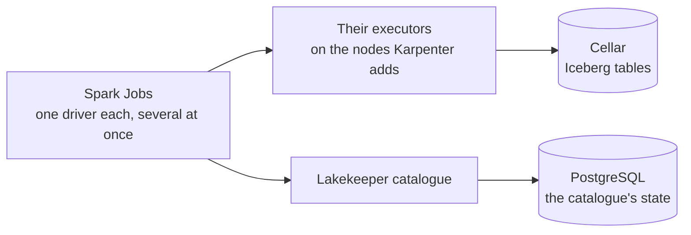

# Recalculate tens of terabytes in batches

A team runs heavy, scheduled processing: recalculations over the whole history, spread over
several machines.

This tutorial builds a lake for that need. The tables are Iceberg tables. Lakekeeper is their
catalogue. Each batch is a Spark Job on a Clever Kubernetes Engine cluster: a driver and its
executors.

## Architecture



- **The tables are Iceberg tables.** Their data and metadata are files on Cellar. The Lakekeeper
  catalogue records which metadata is current. It keeps its state in a managed PostgreSQL.
- **A batch is a Kubernetes Job.** The driver asks the cluster for its executors, runs, and goes
  away. Between two batches, only Lakekeeper runs.
- **The catalogue takes writes in turn.** Lakekeeper accepts one commit at a time per table. Two
  Jobs that write to the same table at the same time commit one after the other. When a commit
  comes second, Iceberg retries it on the new version of the table. No row is lost.
- **The executors follow the work.** With dynamic allocation, a driver asks for executors while
  tasks wait, and gives back an executor idle for 30 seconds. Karpenter, the cluster's node
  manager, adds the nodes the executors need, and removes the nodes they leave empty. Karpenter
  never removes a node where a driver runs.
- **Every layer has a ceiling.** At most 6 executors per Job. A limit on the nodes Karpenter adds.
  A quota on the namespace, for all the Jobs together. Whatever the load, the cluster does not
  grow past these.
- **Iceberg writes each file straight to its place.** It never renames a file: on object storage, a
  rename is a copy. Spark needs no output committer for Iceberg tables.
- **Spark reaches Cellar with the add-on's keys,** given to it in a secret. The keys reach the
  driver and the executors as environment variables only: they appear in neither the Spark
  configuration nor its logs. The catalogue neither hands out keys nor signs requests for Spark:
  the warehouse turns both off.
- **The driver and its executors authenticate each other.** They share a secret that Spark creates
  for each batch, and encrypt what they exchange (`spark.authenticate`). Another pod in the
  cluster can neither join a batch nor read its data in transit.
- **Lakekeeper stays inside the cluster, in a namespace of its own.** It runs on the fixed node, in
  `catalog`. Only the Spark drivers and the warehouse job reach it. A Job can create pods in
  `batch`, so it could read that namespace's secrets: Lakekeeper's secrets are not there.
- **Batches run inside the cluster.** No request goes through the platform's shared load balancer,
  so a batch has no time limit from it.

The [second tutorial](../02-trino-iceberg/) builds an Iceberg lake of the same kind, which Trino
queries. For tables that must be in Delta Lake, the [fourth tutorial](../04-spark-delta/) runs
Spark on Delta tables.

## What this tutorial deploys

| Component | On Clever Cloud |
|---|---|
| The lake | A Cellar add-on and one bucket |
| The catalogue's state | A PostgreSQL add-on |
| The cluster | Clever Kubernetes Engine: one fixed S node, and the nodes Karpenter adds |
| The catalogue | Lakekeeper, one pod, on the fixed node |
| The engine | Spark 4.1 with Iceberg 1.12: one driver Job and up to 6 executors per batch |

| File | Role |
|---|---|
| `main.tf` | The add-ons, the bucket, the cluster with Karpenter and its fixed node, and Lakekeeper's encryption key |
| `namespace.yaml` | The `batch` namespace for the Jobs, the `catalog` namespace for Lakekeeper, and the service account a driver uses to create its executors |
| `nodepool.yaml` | The nodes Karpenter may add, their limit, and the namespace's quota |
| `lakekeeper.yaml` | The Iceberg catalogue, and the NetworkPolicy that lets in the drivers only |
| `warehouse.yaml` | A job that declares the warehouse to the catalogue |
| `iceberg-jobs.yaml` | Four Spark Jobs: create the table, write from two drivers at once, check, compute |
| `iceberg_job.py` | The script the Jobs run |
| `test_iceberg_job.py` | Runs the same example on a local Spark |

You need `terraform`, `kubectl` and the `aws` command line.

## Step 1. Create the managed services and the cluster

The bucket's name must be unique across Cellar.

```bash
export TF_VAR_organisation=<orga_xxx>
export TF_VAR_bucket_name=<a-unique-bucket-name>
terraform init
terraform apply
terraform output -raw kubeconfig > kubeconfig && chmod 600 kubeconfig
export KUBECONFIG=$PWD/kubeconfig
until kubectl get nodes 2>/dev/null | grep -q ' Ready'; do sleep 15; done
kubectl get nodes
```

The step takes about five minutes. Expected: one node `Ready`, the fixed one. Karpenter runs on it.

When Karpenter is turned on, Clever Cloud installs a default NodePool, `clever-general-purpose`,
without limits. This tutorial replaces it with its own, which limits the nodes Karpenter may add,
and sets a quota on the namespace:

```bash
kubectl delete nodepool clever-general-purpose
kubectl apply -f namespace.yaml -f nodepool.yaml
kubectl get nodepools
```

Expected: one NodePool, `spark-executors`, and no node yet. Its limits are 16 vCPU and 16 GB.
With the control plane and the fixed node, they stay under the organisation's Kubernetes Engine
quota: 40 vCPU and 40 GB by default, raised on request to the sales team or the support.
`clever k8s quota --org <org>` shows the usage.

## Step 2. Start the catalogue

Lakekeeper is set up once: this is its bootstrap. Then it receives a warehouse: the bucket and
the prefix under which it keeps a set of tables. Here the warehouse is called `lake`, and Spark
names its catalogue `lake` too. The catalogue's state goes to its PostgreSQL. Its encryption key
comes from Terraform. Lakekeeper's secrets go to the `catalog` namespace. Spark gets the Cellar
keys in a secret of its own, in `batch`.

```bash
kubectl -n catalog create secret generic lakekeeper \
  --from-literal=catalog-uri="$(terraform output -raw catalog_uri)" \
  --from-literal=encryption-key="$(terraform output -raw lakekeeper_encryption_key)"
kubectl -n catalog create secret generic warehouse \
  --from-literal=LAKE_BUCKET="$(terraform output -raw bucket)" \
  --from-literal=CELLAR_HOST="$(terraform output -raw cellar_host)" \
  --from-literal=LAKE_KEY_ID="$(terraform output -raw cellar_key_id)" \
  --from-literal=LAKE_KEY_SECRET="$(terraform output -raw cellar_key_secret)"
kubectl -n batch create secret generic spark \
  --from-literal=CELLAR_HOST="$(terraform output -raw cellar_host)" \
  --from-literal=CELLAR_KEY_ID="$(terraform output -raw cellar_key_id)" \
  --from-literal=CELLAR_KEY_SECRET="$(terraform output -raw cellar_key_secret)"
kubectl apply -f lakekeeper.yaml
kubectl -n catalog rollout status deploy/lakekeeper
kubectl apply -f warehouse.yaml
kubectl -n catalog wait --for=condition=complete job/warehouse --timeout=300s
kubectl -n catalog logs job/warehouse
```

Expected: `bootstrap: 204`, then `warehouse: 201`. Lakekeeper writes a test file to the bucket
before it accepts a warehouse, so a `201` proves it reaches Cellar. On a rerun the job prints
`bootstrap: already done` and `warehouse: already declared`.

## Step 3. Write from two drivers at once, and test

The script `iceberg_job.py` runs in three Jobs, one after the other:

1. `iceberg-init` creates the table `lake.batch.events` with three rows. If the table exists, it
   replaces its rows.
2. `iceberg-writers` starts two drivers at the same time, each with its executors. Each one
   writes ten rows, one commit per row.
3. `iceberg-check` counts the rows of each writer. It fails if any row is missing.

The four Jobs are in one file. `kubectl apply -l step=<step>` applies only the Job with that label.

```bash
kubectl -n batch create configmap jobs --from-file=iceberg_job.py --dry-run=client -o yaml | kubectl apply -f -
for step in init write check; do
  kubectl -n batch delete job -l step=$step --ignore-not-found
  kubectl apply -f iceberg-jobs.yaml -l step=$step
  kubectl -n batch wait --for=condition=complete job -l step=$step --timeout=20m
done
kubectl -n batch logs job/iceberg-check | grep '^{'
```

The first run takes a few minutes: each driver downloads its connectors, then its executor pods
start. Some executors may wait as `Pending` for a node: Spark goes on with those it has. In a
second terminal, `kubectl -n batch get pods -w` shows the progress. A pod in `Error` stops its
Job at once: `kubectl -n batch logs job/<name>` shows why.

Expected:

```
{"rows_per_writer": {"0": 3, "1": 10, "2": 10}, "expected": {"0": 3, "1": 10, "2": 10}, "snapshots": 21, "ok": true}
```

The table has 21 snapshots on the first run: one for the first rows, then one for each of the 20
rows the two drivers write. A new run adds 21 more, and `ok` stays `true`. The two drivers write
at the same time: their logs show commits retried on a newer version of the table, and no row is
missing.

## Step 4. Watch the executors follow the work

`iceberg-compute` is a batch of CPU only. It hashes 20 billion numbers in 96 tasks, and reads and
writes nothing. Its driver starts without executors, and asks for more while tasks wait:

```bash
kubectl apply -f iceberg-jobs.yaml -l step=compute
for i in $(seq 30); do
  [ "$(kubectl -n batch get pods -l spark-role=executor --field-selector=status.phase=Running --no-headers 2>/dev/null | wc -l)" -ge 6 ] && break
  sleep 10
done
kubectl -n batch get pods -l spark-role=executor
kubectl get nodes
kubectl -n batch wait --for=condition=complete job/iceberg-compute --timeout=30m
kubectl -n batch logs job/iceberg-compute | grep '^{'
```

Expected: 6 executor pods, the ceiling, then a line with `"rows": 20000000000`, after a minute or
so of computing. Karpenter adds the nodes the executors need, within the NodePool's limits. About
a minute after the Job ends, it removes them: `kubectl get nodes` shows the fixed node only. The
loop waits five minutes at most: when fewer than 6 executors fit, the Job goes on with those it
has.

## Step 5. Run your own batch

Your batch is the same Job, with your script in the `jobs` ConfigMap. The settings it needs are in
the pod's environment: `LAKEKEEPER_URI`, `CELLAR_HOST`, `AWS_ACCESS_KEY_ID` and
`AWS_SECRET_ACCESS_KEY`. `iceberg_job.py` shows how a Spark session uses them: Iceberg and S3A read
the keys from the environment, so the script never handles them. Its `lake` catalogue holds the Iceberg
tables, and `s3a://` paths read other files on Cellar:
`spark.read.parquet("s3a://<bucket>/raw/")`.

To run it, put your script in the ConfigMap:

```
kubectl -n batch create configmap jobs --from-file=iceberg_job.py --from-file=<your-script>.py --dry-run=client -o yaml | kubectl apply -f -
```

Then copy one of the Jobs of `iceberg-jobs.yaml`, give it a name of its own, and replace
`/jobs/iceberg_job.py` and its argument with your script.

## Step 6. Clean up

Cellar refuses to delete a bucket that still holds files, so the third command empties it. The
`aws` command line needs a region value; Cellar accepts `us-east-1`. Run these commands with the
`TF_VAR_*` variables of step 1 still exported: without them, `terraform destroy` waits for you to
type their values.

```bash
kubectl delete namespace batch catalog
kubectl delete nodepool spark-executors
AWS_ACCESS_KEY_ID=$(terraform output -raw cellar_key_id) \
AWS_SECRET_ACCESS_KEY=$(terraform output -raw cellar_key_secret) AWS_DEFAULT_REGION=us-east-1 \
  aws s3 rm "s3://$(terraform output -raw bucket)" --recursive --endpoint-url "https://$(terraform output -raw cellar_host)"
terraform destroy
rm -f kubeconfig
```

To keep the tables without a cluster between batches, remove only the cluster:
`terraform destroy -target=clevercloud_kubernetes.spark`. The catalogue's state stays in
PostgreSQL, its key in the Terraform state, and the files on Cellar. A later `terraform apply`
creates the cluster again, and steps 1 and 2 start the catalogue on the same state.

## To adapt

- **The script.** Your processing goes in the Job's script, as in step 5.
- **The executors.** Their size and `spark.dynamicAllocation.maxExecutors` are in
  `iceberg-jobs.yaml`. Raise the NodePool's limits and the namespace's quota with them, in
  `nodepool.yaml`.
- **Scheduling.** An orchestrator, Airflow or another, launches the Jobs.
- **Upkeep.** Many small commits make many small files, and each snapshot keeps its files.
  `CALL lake.system.rewrite_data_files('batch.events')` merges small files.
  `CALL lake.system.expire_snapshots(table => 'batch.events', older_than => TIMESTAMP '2026-11-01 00:00:00')`
  removes the snapshots older than that date. Without `older_than`, it removes those older than
  5 days. The date is a literal: the procedure refuses an expression.
  `CALL lake.system.remove_orphan_files(table => 'batch.events')` deletes the files no snapshot
  uses. A Job runs them on a schedule.

## Limits

- **Spark is run by you.** Its images, versions, connectors and memory settings are yours. The
  Iceberg connector follows Spark's versions: Iceberg 1.12 runs on Spark 4.0 and 4.1.
- **A batch's resources.** As deployed, a batch has at most 6 executors of 2 cores and 2 GB. The
  shuffle files of a batch go to the executors' local disk. Larger batches need larger
  executors, more of them, and the NodePool's limits and the quota raised with them.
- **One key pair for the lake.** Spark reaches Cellar with the Cellar add-on's keys: a holder of
  the keys reads, writes and deletes every file of the bucket.
- **Volume.** For a few terabytes, DuckDB on one instance, as in the
  [first tutorial](../01-duckdb-ducklake/), handles the volume without a cluster.

## Documentation

- Spark on Kubernetes: https://spark.apache.org/docs/latest/running-on-kubernetes.html
- Spark dynamic allocation: https://spark.apache.org/docs/latest/job-scheduling.html#dynamic-resource-allocation
- Iceberg with Spark: https://iceberg.apache.org/docs/latest/spark-getting-started/
- Iceberg's Spark procedures: https://iceberg.apache.org/docs/latest/spark-procedures/
- Lakekeeper: https://docs.lakekeeper.io/
- Karpenter: https://karpenter.sh/docs/
- Clever Kubernetes Engine: https://www.clever.cloud/developers/doc/kubernetes/
- Cellar: https://www.clever.cloud/developers/doc/deploy/storage/cellar/

## Troubleshooting

| Symptom | Cause | Fix |
|---|---|---|
| `terraform apply` fails: the bucket already exists | Bucket names are unique across Cellar | Choose another `TF_VAR_bucket_name`. |
| `terraform apply` fails with "quota exceeded" | Another cluster uses the organisation's quota | `clever k8s quota --org <org>` shows the usage.<br>Run one Kubernetes Engine tutorial at a time.<br>Ask for a higher quota. |
| `kubectl create secret` fails: the secret already exists | The step ran before | `kubectl -n <namespace> delete secret <name>`, then run the command again. |
| The warehouse job ends with `warehouse: 4xx` | Lakekeeper could not write its test file to the bucket | Check the `warehouse` secret, delete the job, apply it again. |
| A Job fails with "Access Denied" on Cellar | The `spark` secret holds wrong keys | Recreate it from `terraform output`. |
| A driver cannot reach `lakekeeper.catalog.svc:8181` | The pod lacks the `lakekeeper-client: "true"` label | Keep the label in the Job's template, as `iceberg-jobs.yaml` does. |
| A Job fails with `CommitFailedException` | Many Jobs commit to the same table at once, beyond the retries | Raise `commit.retry.num-retries` on the table.<br>Commit less often: one commit per batch rather than per row. |
| An executor stays `Pending` | The NodePool's limit is reached, or the organisation's quota | Normal at the ceiling: the Job goes on with the executors it has.<br>Raise the limits in `nodepool.yaml`, within the quota. |
| A Job's pod is not created: "exceeded quota" | Other Jobs use the namespace's quota | Wait for them to end, or raise the quota in `nodepool.yaml`. |
| A Job must run again after a fix | `kubectl apply` leaves a completed Job as it is | `kubectl -n batch delete job <name>`, then apply it again. |

## Develop and test

```bash
uv sync
JAVA_HOME=<a Java 17 or 21> uv run pytest
```

The tests run the example on a local Spark, with a local Iceberg catalogue: three writers at once,
a second run on the same table, a missing row that fails the check, and the compute batch.
Without Java 17 or 21, pytest reports them as skipped.
