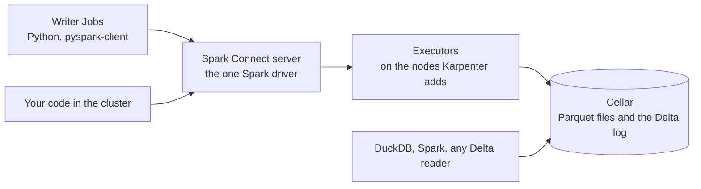

# Take over or share Delta Lake tables

Some tables are already in Delta Lake, written by Databricks or Microsoft Fabric. Some tools read
only Delta. Some specifications require Delta. This tutorial keeps Delta tables on Clever Cloud,
lets several writers work on them at the same time, and reads them without Spark.

For a new lake without these constraints, the [first tutorial](../01-duckdb-ducklake/) covers
DuckLake, and the [second](../02-trino-iceberg/) covers Iceberg.

## Architecture



- **The tables are Delta tables.** Their data is Parquet files on Cellar. Their history is the
  Delta log: a directory of numbered commit files, next to the data.
- **One Spark driver commits every write.** It is a Spark Connect server, always running on a
  Clever Kubernetes Engine cluster. Writers send it their queries, and it commits their writes one
  after the other: writers working at the same time lose nothing.
- **Why one driver.** Delta's log needs something that stops two writers from creating the same
  commit at once. On Cellar, the one driver does it. Two Spark drivers writing to the same table
  at the same time can lose data, so every write goes through the server.
- **One server at a time.** The server runs as a StatefulSet of one pod, on the fixed node.
  Kubernetes starts a new pod only once the old one is gone, and Karpenter, the cluster's node
  manager, never moves it.
- **The executors follow the writers.** With dynamic allocation, the server asks for executors
  while queries wait, and gives back an executor idle for 30 seconds. Karpenter adds the nodes the
  executors need, and removes the nodes they leave empty. With no writer, only the server runs.
- **Every layer has a ceiling.** At most 4 executors. A limit on the nodes Karpenter adds. A quota
  on the namespace. Whatever the load, the cluster does not grow past these.
- **Writers are thin clients inside the cluster.** A writer is a Python process with
  `pyspark-client`, without Java or Spark. It runs in a pod of the cluster: in this tutorial, the
  writers are Kubernetes Jobs. A writer gets the bucket's name only, and no Cellar key.
- **Only the writers reach the server.** The server is reachable inside the cluster only. A
  NetworkPolicy lets in only the pods labelled `delta-writer: "true"`. The label is the server's
  only check: it has no password or token of its own.
- **The keys stay out of the configuration.** The server and its executors get the Cellar keys as
  environment variables, from the `lake` secret. They appear in neither the Spark configuration
  nor its logs.
- **The server and its executors authenticate each other.** They share a secret that Spark
  creates when the server starts, and encrypt what they exchange (`spark.authenticate`). Another
  pod in the cluster can neither join the server's executors nor read their data in transit.
- **The lake does not depend on the cluster.** Cellar and its bucket are managed services. The
  cluster can be resized, deleted or created again: the tables stay.
- **Readers need no Spark.** DuckDB and Spark read the tables at their path in the bucket: a
  table's log is enough, with no catalogue.
- **Everything runs inside the cluster.** No request goes through the platform's shared load
  balancer, so a query has no time limit from it.

## What this tutorial deploys

| Component | On Clever Cloud |
|---|---|
| The lake | A Cellar add-on and one bucket |
| The cluster | Clever Kubernetes Engine: one fixed S node, and the nodes Karpenter adds |
| The engine | A Spark Connect server, Spark 4.2 with Delta Lake 4.4, on the fixed node, and up to 4 executors |

| File | Role |
|---|---|
| `main.tf` | The lake, its bucket, the cluster with Karpenter, and its fixed node |
| `namespace.yaml` | The `delta` namespace, and the service account the server uses to create executors |
| `nodepool.yaml` | The nodes Karpenter may add, their limit, and the namespace's quota |
| `spark-connect.yaml` | The Spark Connect server, its service and its NetworkPolicy |
| `delta-writers.yaml` | Three Jobs of writers: create the table, write from two pods at once, check |
| `delta_client.py` | The writers' script, a Spark Connect client |
| `test_delta_client.py` | Runs the writers' example on a local Spark |

You need `terraform`, `kubectl`, the `aws` command line, and `duckdb` with its `delta` extension.

## Step 1. Create the lake and the cluster

The bucket's name must be unique across Cellar.

```bash
export TF_VAR_organisation=<orga_xxx>
export TF_VAR_bucket_name=<a-unique-bucket-name>
terraform init
terraform apply
terraform output -raw kubeconfig > kubeconfig && chmod 600 kubeconfig
export KUBECONFIG=$PWD/kubeconfig
until kubectl get nodes 2>/dev/null | grep -q ' Ready'; do sleep 15; done
kubectl get nodes
```

The step takes about five minutes. Expected: one node `Ready`, the fixed one. Karpenter runs on it.

When Karpenter is turned on, Clever Cloud installs a default NodePool, `clever-general-purpose`,
without limits. This tutorial replaces it with its own, which limits the nodes Karpenter may add,
and sets a quota on the namespace:

```bash
kubectl delete nodepool clever-general-purpose
kubectl apply -f namespace.yaml -f nodepool.yaml
kubectl get nodepools
```

Expected: one NodePool, `spark-executors`, and no node yet. Its limits are 16 vCPU and 16 GB.
With the control plane and the fixed node, they stay under the organisation's Kubernetes Engine
quota: 40 vCPU and 40 GB by default, raised on request to the sales team or the support.
`clever k8s quota --org <org>` shows the usage.

## Step 2. Start the Spark Connect server

The server gets Cellar's address and keys from a secret. The writers get the bucket's name from a
ConfigMap. The keys go from Terraform to the secret without being printed.

```bash
kubectl -n delta create secret generic lake \
  --from-literal=CELLAR_HOST="$(terraform output -raw cellar_host)" \
  --from-literal=CELLAR_KEY_ID="$(terraform output -raw cellar_key_id)" \
  --from-literal=CELLAR_KEY_SECRET="$(terraform output -raw cellar_key_secret)"
kubectl -n delta create configmap lake-settings --from-literal=LAKE_BUCKET="$(terraform output -raw bucket)"
kubectl apply -f spark-connect.yaml
kubectl -n delta rollout status statefulset/spark-connect --timeout=15m
kubectl -n delta get pods
```

The first start takes a few minutes: the server downloads the Delta and S3 connectors. Expected:
the `spark-connect-0` pod `Running`, and no executor yet. The server starts executors when work
comes.

## Step 3. Write from two writers at once, and test

The writers' script, `delta_client.py`, runs in three Jobs, one after the other:

1. `delta-init` creates the table `delta/events` of the bucket with three rows. If the table
   exists, it replaces its rows.
2. `delta-writers` starts two pods at the same time. Each one writes ten rows, one commit per
   row.
3. `delta-check` counts the rows of each writer. It fails if any row is missing.

The three Jobs are in one file. `kubectl apply -l step=<step>` applies only the Job with that label.

```bash
kubectl -n delta create configmap clients --from-file=delta_client.py --dry-run=client -o yaml | kubectl apply -f -
for step in init write check; do
  kubectl -n delta delete job -l step=$step --ignore-not-found
  kubectl apply -f delta-writers.yaml -l step=$step
  kubectl -n delta wait --for=condition=complete job -l step=$step --timeout=15m
done
kubectl -n delta logs job/delta-check | grep '^{'
```

Each pod installs `pyspark-client` first, which takes about a minute. In a second terminal,
`kubectl -n delta get pods -w` shows the progress. A writer pod in `Error` stops its Job at once:
`kubectl -n delta logs job/<name>` shows why.

Expected:

```
{"rows_per_writer": {"0": 3, "1": 10, "2": 10}, "expected": {"0": 3, "1": 10, "2": 10}, "version": 21, "ok": true}
```

The table is at version 21: version 0 is its creation, version 1 the first rows, then one commit
for each of the 20 rows the two pods write. The two pods write at the same time, and their
commits interleave. A new run replaces the rows and adds 21 versions.

Only the writers reach the server. A pod without the label is refused:

```bash
kubectl -n delta run probe --image=busybox:1.37 --restart=Never --command -- \
  sh -c 'nc -z -w 5 spark-connect 15002 && echo OPEN || echo REFUSED'
kubectl -n delta wait --for=jsonpath='{.status.phase}'=Succeeded pod/probe --timeout=2m
kubectl -n delta logs probe
kubectl -n delta delete pod probe
```

Expected: `REFUSED`. The same pod with `--labels=delta-writer=true` prints `OPEN`.

## Step 4. Watch the executors come and go

While the writers ran, the server started executors, and Karpenter added the nodes they needed.
Thirty seconds after the last query, the server gives them back:

```bash
for i in $(seq 40); do
  [ "$(kubectl -n delta get pods -l spark-role=executor --no-headers 2>/dev/null | wc -l)" -eq 0 ] && \
  [ "$(kubectl get nodes --no-headers | wc -l)" -eq 1 ] && break
  sleep 15
done
kubectl -n delta get pods -l spark-role=executor
kubectl get nodes
```

Expected, about two minutes after the writers: no executor, and the fixed node only. An executor
is given back after 30 seconds idle, even if it holds data from an earlier query. Karpenter
removes a node 30 seconds after it is empty. The next writer brings the executors back. The loop
waits ten minutes at most.

## Step 5. Read without Spark

DuckDB reads the same table, from a workstation or an application, with its `delta` extension.
It reads the current version, or an earlier one.

```bash
BUCKET=$(terraform output -raw bucket)
duckdb <<SQL
INSTALL delta; INSTALL httpfs;
CREATE SECRET cellar (TYPE s3, KEY_ID '$(terraform output -raw cellar_key_id)',
                      SECRET '$(terraform output -raw cellar_key_secret)',
                      ENDPOINT '$(terraform output -raw cellar_host)', URL_STYLE 'path', REGION 'us-east-1');
SELECT writer, count(*) AS n FROM delta_scan('s3://$BUCKET/delta/events') GROUP BY writer ORDER BY writer;
SELECT count(*) AS rows_at_version_1 FROM delta_scan('s3://$BUCKET/delta/events', version => 1);
SQL
```

Expected: 3 rows for writer 0, and 10 each for writers 1 and 2. Then 3 rows at version 1, the
first rows.

## Step 6. Write from your own code

A Python program with `pyspark-client` 4.2 writes through the server, from a pod labelled
`delta-writer: "true"` in the `delta` namespace. The writers' Jobs of `delta-writers.yaml` show
the pod's settings:

```python
from pyspark.sql import SparkSession

spark = SparkSession.builder.remote("sc://spark-connect:15002").getOrCreate()
spark.sql("INSERT INTO delta.`s3a://<bucket>/delta/events` VALUES (3, 1)")
```

The DataFrame API works the same: `df.write.format("delta").mode("append").save(path)`. The
server runs the code on its executors, with its own memory. The address has no `;token=`: with a
token, the client speaks TLS, which the server does not.

## Step 7. Take over a table written elsewhere

A Delta table is a directory: its Parquet files, and its `_delta_log`. Taking it over means
copying the directory to the bucket, with the tool that reads its current storage. While the
copy runs, nothing writes to the source table. The data files go first, the `_delta_log` last:
the log then only names files that are already there.

Before the copy, the source's Spark tells which features the table uses:

```sql
DESCRIBE DETAIL delta.`<path of the table>`
```

`minReaderVersion`, `minWriterVersion` and `tableFeatures` list them. The server's Delta 4.4 and
DuckDB's `delta` extension each support a set of table features, which their documentation lists:
compare it with the table's. Tables that a catalogue manages, such as Unity Catalog's managed
tables, are copied from their storage location, which the catalogue gives.

## Step 8. Clean up

Cellar refuses to delete a bucket that still holds files, so the third command empties it. The
`aws` command line needs a region value; Cellar accepts `us-east-1`. Run these commands with the
`TF_VAR_*` variables of step 1 still exported: without them, `terraform destroy` waits for you to
type their values.

```bash
kubectl delete namespace delta
kubectl delete nodepool spark-executors
AWS_ACCESS_KEY_ID=$(terraform output -raw cellar_key_id) \
AWS_SECRET_ACCESS_KEY=$(terraform output -raw cellar_key_secret) AWS_DEFAULT_REGION=us-east-1 \
  aws s3 rm "s3://$(terraform output -raw bucket)" --recursive --endpoint-url "https://$(terraform output -raw cellar_host)"
terraform destroy
rm -f kubeconfig
```

To keep the tables without a cluster, remove only the cluster:
`terraform destroy -target=clevercloud_kubernetes.spark`. A later `terraform apply` creates it
again, and the tables are where they were.

## To adapt

- **The writers.** Your code connects to the server as in step 6, from Jobs or applications in the
  cluster.
- **The executors.** Their size and `spark.dynamicAllocation.maxExecutors` are in
  `spark-connect.yaml`. Every writer shares them. Raise the NodePool's limits and the namespace's
  quota with them, in `nodepool.yaml`.
- **Scheduling.** An orchestrator, Airflow or another, launches the writers' Jobs.
- **Upkeep.** Many small commits make many small files. Through the server,
  ``OPTIMIZE delta.`s3a://<bucket>/delta/events` `` merges small files, and
  ``VACUUM delta.`s3a://<bucket>/delta/events` RETAIN 168 HOURS`` deletes the files that no
  version of the last 7 days uses. An orchestrator runs them on a schedule.
- **History.** A Delta table reads its earlier versions while its log keeps them, 30 days by
  default (`delta.logRetentionDuration`), and while VACUUM has not deleted their files.

## Limits

- **Every write goes through the server.** A Spark job that writes to the same tables with its own
  driver, next to the server, can lose data. So can any tool that writes to `_delta_log` with the
  Cellar keys. Writers use the server.
- **One server.** Its memory and its executors are shared by every writer. A restart of the server
  stops the writers' running queries.
- **Inside the cluster.** The server is reachable from the cluster's pods only: an application
  outside the cluster writes through a pod inside it.
- **One key pair for the lake.** The server and the DuckDB readers reach Cellar with the Cellar
  add-on's keys: a holder of the keys reads, writes and deletes every file of the bucket.
- **Trino.** Trino's Delta Lake connector reads the tables once they are registered in a metastore.
- **Spark is run by you.** Its images, versions, connectors and memory settings are yours.

For batch processing on Iceberg tables, the [third tutorial](../03-spark-iceberg/) runs Spark
Jobs with a Lakekeeper catalogue.

## Documentation

- Delta Lake storage configuration: https://docs.delta.io/latest/delta-storage.html
- Delta Lake table features: https://docs.delta.io/latest/versioning.html
- Spark Connect: https://spark.apache.org/docs/latest/spark-connect-overview.html
- Spark dynamic allocation: https://spark.apache.org/docs/latest/job-scheduling.html#dynamic-resource-allocation
- Spark on Kubernetes: https://spark.apache.org/docs/latest/running-on-kubernetes.html
- DuckDB's Delta extension: https://duckdb.org/docs/current/core_extensions/delta
- Karpenter: https://karpenter.sh/docs/
- Clever Kubernetes Engine: https://www.clever.cloud/developers/doc/kubernetes/
- Cellar: https://www.clever.cloud/developers/doc/deploy/storage/cellar/

## Troubleshooting

| Symptom | Cause | Fix |
|---|---|---|
| `terraform apply` fails: the bucket already exists | Bucket names are unique across Cellar | Choose another `TF_VAR_bucket_name`. |
| `terraform apply` fails with "quota exceeded" | Another cluster uses the organisation's quota, or one was deleted less than a minute ago | `clever k8s quota --org <org>` shows the usage.<br>Run one Kubernetes Engine tutorial at a time.<br>Ask for a higher quota. |
| `kubectl create secret` or `configmap` fails: it already exists | Step 2 ran before | `kubectl -n delta delete secret lake configmap lake-settings`, then run step 2 again. |
| An executor stays `Pending` | The NodePool's limit is reached, or the organisation's quota | Normal at the ceiling: the server goes on with the executors it has.<br>Raise the limits in `nodepool.yaml`, within the quota. |
| The first query after a quiet period is slow | The server starts its executors again, and Karpenter their nodes | Normal.<br>Set `spark.dynamicAllocation.minExecutors` to keep some running. |
| A writer waits without end, then fails to connect | The pod lacks the `delta-writer: "true"` label | Add the label to the pod's template. |
| A read fails with a 403 from Cellar | The keys or the endpoint are wrong | Run step 2 again from the Terraform outputs.<br>`path.style.access` and `URL_STYLE 'path'` are required. |

## Develop and test

```bash
uv sync
JAVA_HOME=<a Java 17 or 21> uv run pytest
```

The tests run the writers' example on a local Spark, in a temporary directory: three writers at
once, a second run on the same table, and a missing row that fails the check. Without Java 17
or 21, pytest reports them as skipped.
